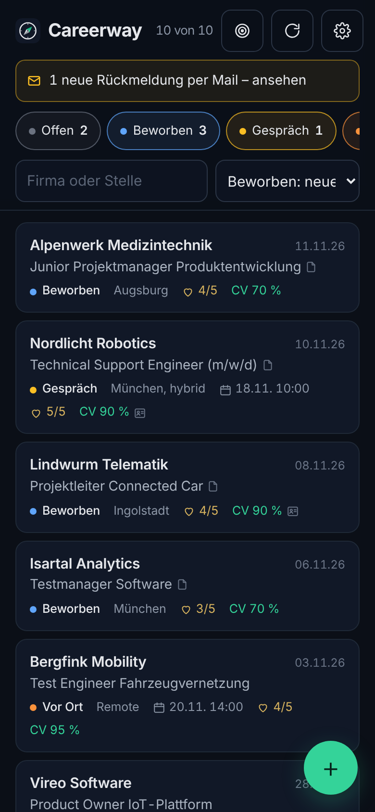
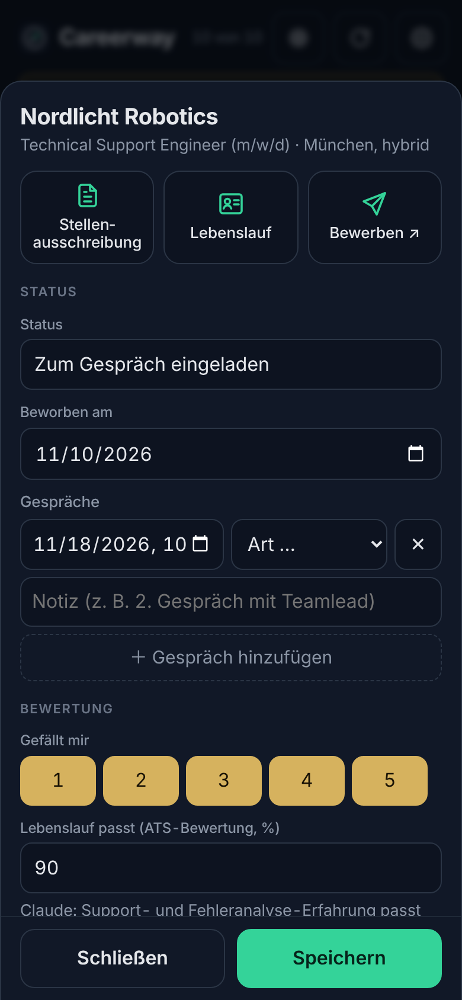
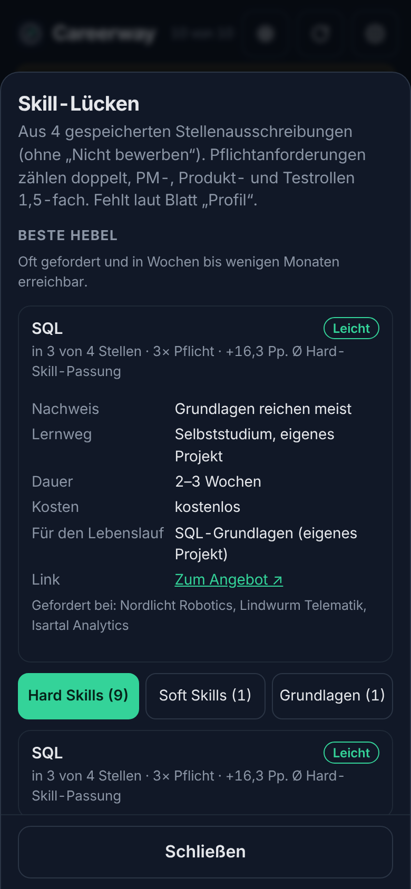
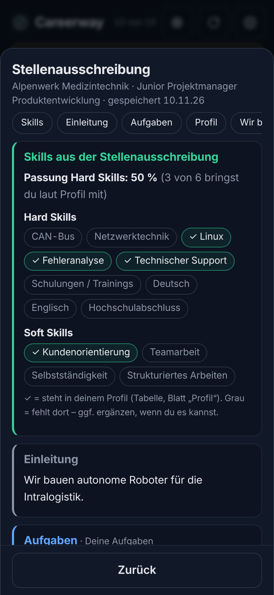
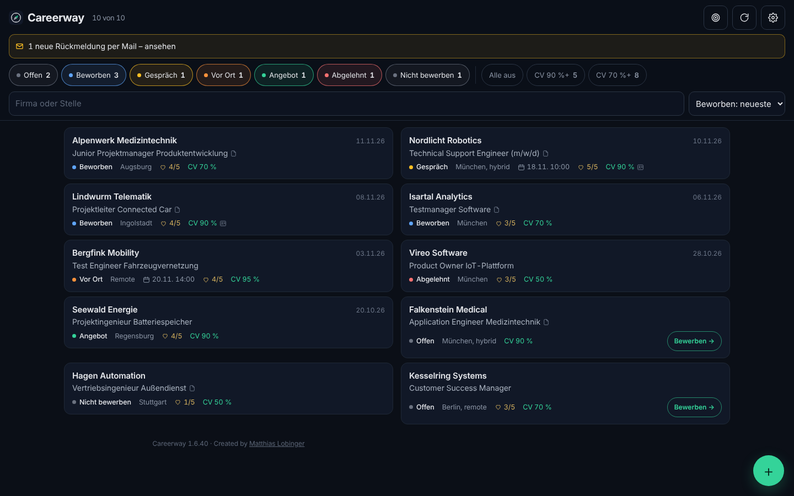

# Careerway

[English](README.md) | **Deutsch**

Ein persönlicher Bewerbungs-Tracker, der auf einer Google-Tabelle läuft, mit einer Web-App für Handy, Tablet und Rechner.

Erstellt von [Matthias Lobinger](https://www.linkedin.com/in/matthias-lobinger)

[Live-Demo mit Beispieldaten](https://lobi1994.github.io/Job-Tracker/#demo) | [Geführte Tour](https://lobi1994.github.io/Job-Tracker/#tour)

<p>
  
  
  
  
</p>
<p>
  
</p>

Alle Screenshots zeigen erfundene Beispieldaten.

Das [Wiki](https://github.com/lobi1994/Job-Tracker/wiki) erklärt Anforderungen, Funktionen, Architektur, Entscheidungen und Lessons learned.

## Warum

Wer sich über viele Portale bewirbt, verliert schnell den Überblick. Stellenanzeigen verschwinden, bevor die Einladung zum Gespräch kommt. Und über viele Anzeigen hinweg ist schwer zu sehen, welche Fähigkeiten einem fehlen.

Careerway hält das an einem Ort fest. Die Daten gehören dir: Sie liegen in deiner eigenen Google-Tabelle, ohne fremden Server und ohne laufende Kosten.

## Funktionen

- Status je Bewerbung: nicht beworben, beworben, eingeladen, Gespräch vor Ort, Angebot, abgelehnt, nicht bewerben. Filter, Suche und Sortierung.
- Mehrere Gespräche pro Job, jeweils mit Datum, Art (Telefon, Video, vor Ort, Assessment Center) und Notiz.
- iOS-Kurzbefehl „Job speichern“: speichert den vollen Text einer Stellenanzeige aus Safari oder LinkedIn in die Tabelle.
- Die Anzeige wird gegliedert angezeigt (Aufgaben, Profil, Benefits) und lässt sich auf Wunsch ins Englische übersetzen.
- CV-Passung in Prozent, bewertet wie ein Applicant Tracking System: Die Anforderungen kommen aus der Anzeige, Pflichtanforderungen zählen doppelt und werden mit deinem Profil abgeglichen. Der Wert bleibt leer, bis die Anzeige gespeichert ist. Filter für 90 %+ und 70 %+.
- Skill-Lücken: zählt über alle gespeicherten Anzeigen, welche geforderten Fähigkeiten fehlen und wie oft sie Pflicht sind, und zeigt je Lücke einen Lernweg mit Dauer und Kosten.
- Gmail-Abgleich: erkennt Eingangsbestätigungen, Einladungen und Absagen und schlägt den neuen Status vor.
- Sofort speichern: Änderungen erscheinen sofort und werden im Hintergrund gespeichert. Ohne Netz warten sie auf dem Gerät.
- Läuft als Home-Screen-App, startet aus dem Gerätespeicher, auf Deutsch und Englisch.

## Aufbau

```
iOS-Kurzbefehl --+
                 |  HTTPS POST mit Schlüssel
Web-App ---------+-------------------->  Google Apps Script  -->  Google-Tabelle
(GitHub Pages,                           (Web-App)               Blätter: Bewerbungen,
 eine statische Seite,                         |                          Anzeigen,
 Service Worker)                               +-- Gmail (optional)       Profil,
                                               +-- Drive (optional)       Lernplan
```

Die Web-App ist eine statische Seite auf GitHub Pages. Sie spricht mit einer Google-Apps-Script-Web-App, die die Tabelle liest und schreibt. Gmail liest das Script, zugeschnittene CVs liegen in Google Drive. Beides ist optional.

Es gibt keinen Build-Schritt, kein Framework und keinen eigenen Server.

## Technik

- HTML, CSS und reines JavaScript
- Google Apps Script
- Google Sheets als Datenbank
- GitHub Pages zum Hosten
- iOS-Kurzbefehle
- Tests mit Node und jsdom, ausgeführt in GitHub Actions

## Datenschutz und Sicherheit

- Deine Daten bleiben in deinem eigenen Google-Konto.
- Zugriff gibt es nur mit einem zufälligen Schlüssel aus 24 Zeichen. Er liegt im Script, nicht in diesem Repository.
- Der Schlüssel wird aus der Adresszeile entfernt, sobald die App ihn übernommen hat.
- Text aus Webseiten und Mails wird beim Schreiben in die Tabelle gegen Formeln geschützt.
- Einen neuen Schlüssel kannst du jederzeit im Tabellenmenü erzeugen.

## Eigene Kopie einrichten

Etwa 15 Minuten. Du brauchst ein Google-Konto.

1. Lege eine neue Google-Tabelle an, zum Beispiel über sheets.new.
2. Öffne Erweiterungen, dann Apps Script, und füge den Inhalt von `google/Code.gs` ein. Stelle die Zeitzone auf Berlin.
3. Lade die Tabelle neu und wähle im Menü „Careerway“ den Punkt „Einrichten“. Bestätige die Berechtigungen. Dabei entsteht auch dein Schlüssel.
4. Wähle in Apps Script Bereitstellen, dann Neue Bereitstellung, Typ Web-App. Ausführen als „Ich“, Zugriff „Jeder“. Ohne deinen Schlüssel kann niemand etwas lesen oder ändern.
5. Wähle in der Tabelle „Careerway“, dann „App-Link anzeigen“, füge auf Nachfrage die Web-App-URL ein und öffne den Einrichtungs-Link in Safari. Lege die Seite danach auf den Home-Bildschirm.
6. Richte den Kurzbefehl „Job speichern“ über die Seite ein, die in den App-Einstellungen verlinkt ist.

Der Gmail-Abgleich ist optional und hat eigene Schritte. Die Details zu jedem Schritt stehen in [ANLEITUNG.md](ANLEITUNG.md).

## Entwicklung

```
npm install
npm test
```

App und Script teilen sich einen Versionszähler. In [CHANGELOG.md](CHANGELOG.md) steht, was sich in jeder Version geändert hat und ob das Script neu bereitgestellt werden muss.

## Roadmap

- Erinnerungen zum Nachfassen
- Statistiken: Bewerbungen pro Woche, Antwortquote, Status-Trichter
- CSV-Export
- Zweispaltiges Layout am Rechner

## Hinweis

Entstanden mit Hilfe von Claude (Anthropic) als Coding-Assistent. Konzept, Anforderungen und Tests an echten Bewerbungen stammen von Matthias.
