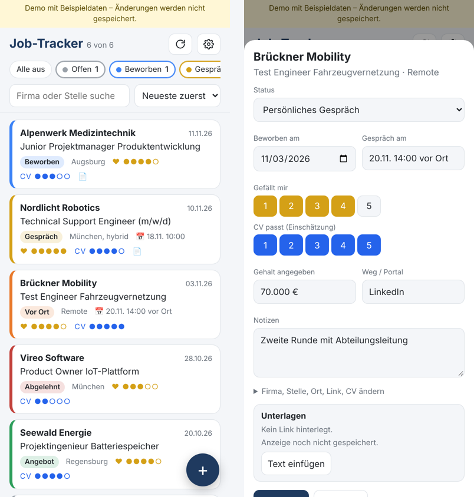

# Job-Tracker

[Deutsch](README.md) | **English**

A small web app I use to manage my job applications. The data lives in my own Google Sheet; the app runs on iPhone, iPad and desktop. The interface is in German.

**Try it without setup:** [demo with sample data](https://lobi1994.github.io/Job-Tracker/#demo)

## Features

- **Status per application:** not applied → applied → invited to interview → on-site interview → offer / rejected
- **Status filters you can switch on and off**, search by company or role, sorting by date, status or rating
- **Two ratings:** how much I like the role and how well my CV fits it (1–5 each)
- **Save the job posting:** from its link, as pasted text, or with an iOS shortcut straight from Safari, so the posting stays readable after it goes offline
- **Interview dates, salary stated, portal, CV file and notes** per application, with a link to the CV file in Google Drive
- Works as a home-screen app and shows the last state instantly on start

## How it is built

| Part | Technology | Job |
|---|---|---|
| Database | Google Sheets | one tab "Bewerbungen" (applications), one tab "Anzeigen" (posting texts) |
| API | Google Apps Script (`google/Code.gs`) | web app with a JSON API, key check, fetching and parsing job postings (JSON-LD `JobPosting`) |
| Front end | plain HTML, CSS and JavaScript (`index.html`) | hosted on GitHub Pages, service worker for a fast start |
| Shortcut | iOS Shortcuts + `kurzbefehle/job-speichern.js` | reads the open posting in Safari and sends it to the sheet |

Your data stays in your Google Sheet. This GitHub page only holds the interface, no data. Without your personal key nobody can read or change anything.

## Setup

Step by step in the [setup guide (German)](ANLEITUNG.md), about 15 minutes.

## Limits

- LinkedIn and some Workday pages can't be fetched from their link. Use the Safari shortcut or paste the text instead.
- A posting is stored with at most 45,000 characters (Google Sheets cell limit).
