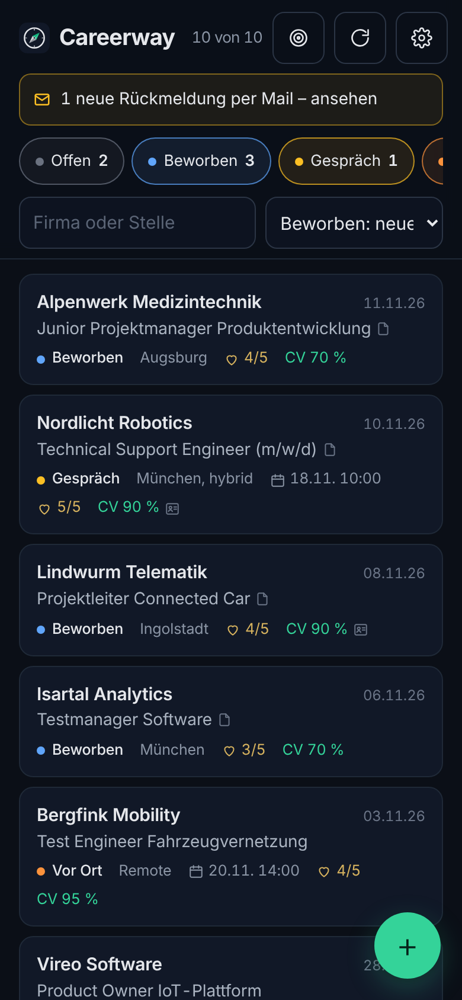
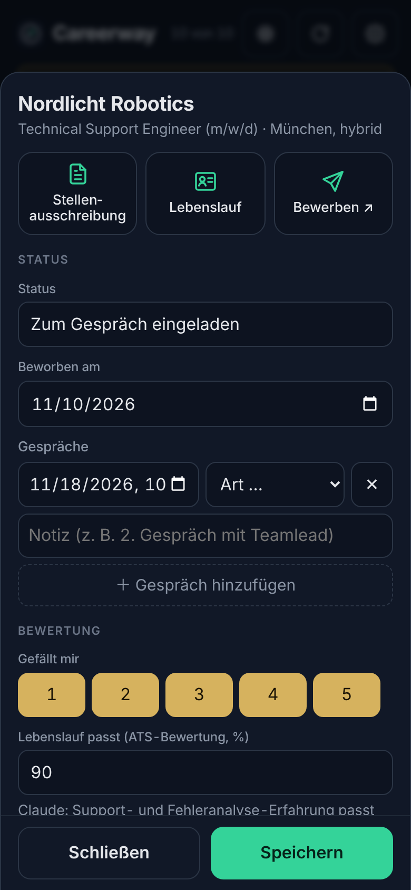
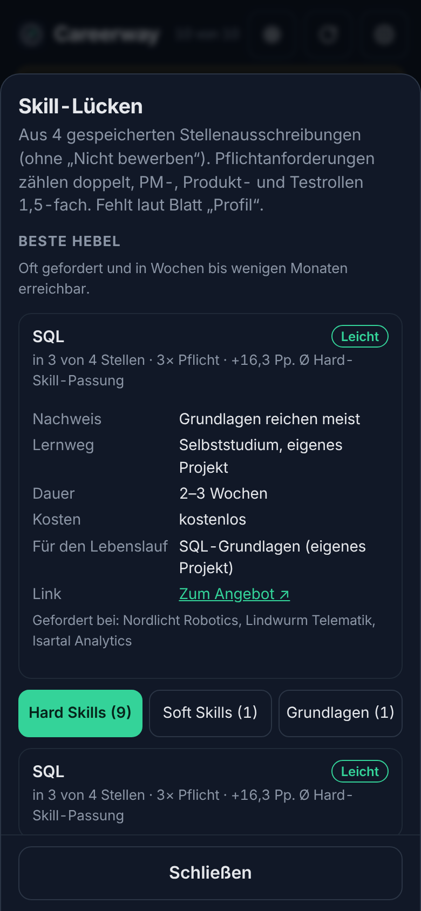
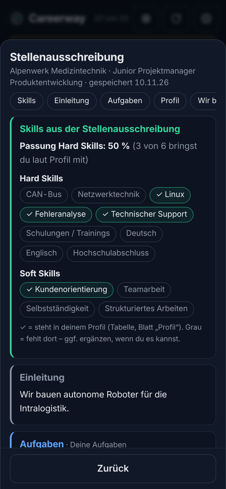
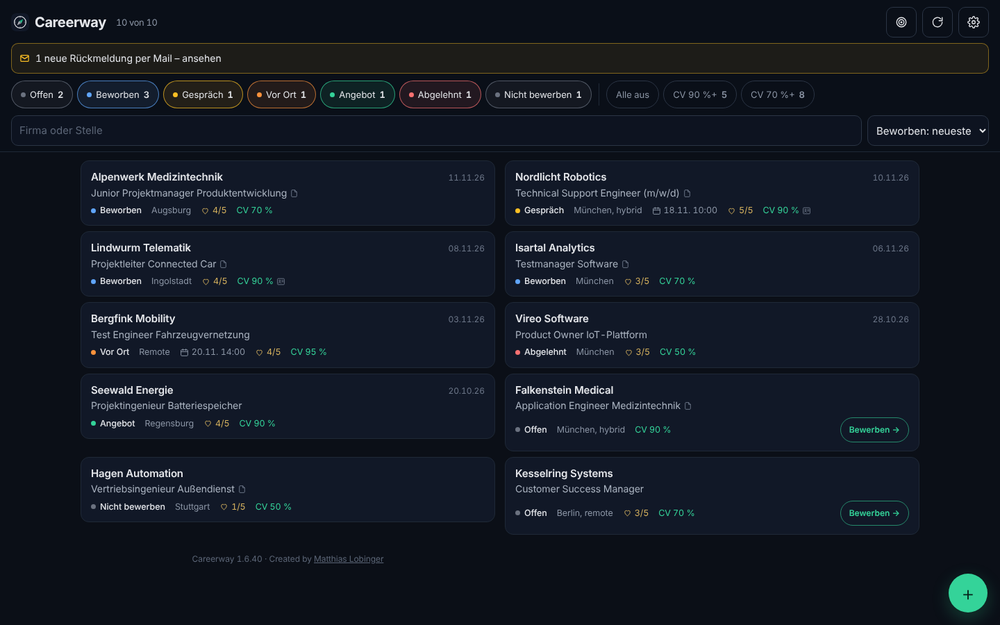

# Careerway

**English** | [Deutsch](README.de.md)

A personal job application tracker that runs on a Google Sheet, with a web app for phone, tablet and desktop.

Created by [Matthias Lobinger](https://www.linkedin.com/in/matthias-lobinger)

[Live demo with sample data](https://lobi1994.github.io/Job-Tracker/#demo) | [Guided tour](https://lobi1994.github.io/Job-Tracker/#tour)

<p>
  
  
  
  
</p>
<p>
  
</p>

All screenshots show made-up sample data.

The [wiki](https://github.com/lobi1994/Job-Tracker/wiki/Home-EN) explains requirements, features, architecture, decisions and lessons learned.

## Why

When you apply through many portals, you lose track of where you stand. Job postings disappear before the interview invitation arrives. And across dozens of postings it is hard to see which skills you are missing.

Careerway keeps all of that in one place. The data belongs to you: it lives in your own Google Sheet, with no third-party server and no running costs.

## Features

- Status for each application: not applied, applied, invited, on-site interview, offer, rejected, not applying. Filters, search and sorting.
- Several interviews per job, each with a date, a type (phone, video, on site, assessment center) and a note.
- iOS shortcut "Job speichern": saves the full text of a posting from Safari or LinkedIn into the sheet.
- The posting is shown in sections (tasks, profile, benefits) and can be translated into English on request.
- CV fit in percent, scored like an applicant tracking system: requirements are taken from the posting, must-have requirements count double, and they are matched against your own profile. The value stays empty until the posting is saved. Filters for 90 %+ and 70 %+.
- Skill gaps: counts across all saved postings which required skills you lack and how often they are must-haves, and shows a learning path for each gap with duration and cost.
- Gmail check: recognizes confirmations, invitations and rejections and suggests the new status.
- Instant saving: changes show up at once and are saved in the background. Without a connection they wait on the device.
- Runs as a home-screen app, starts from device storage, available in German and English.

## Architecture

```
iOS Shortcut ----+
                 |  HTTPS POST with key
Web app ---------+-------------------->  Google Apps Script  -->  Google Sheet
(GitHub Pages,                           (web app)               tabs: Bewerbungen,
 one static page,                              |                       Anzeigen,
 service worker)                               +-- Gmail (optional)    Profil,
                                               +-- Drive (optional)    Lernplan
```

The web app is one static page on GitHub Pages. It talks to a Google Apps Script web app, which reads and writes the sheet. Gmail is read by the script, and tailored CVs are stored in Google Drive. Both are optional.

There is no build step, no framework and no server of my own.

## Tech stack

- HTML, CSS and vanilla JavaScript
- Google Apps Script
- Google Sheets as the database
- GitHub Pages for hosting
- iOS Shortcuts
- Tests with Node and jsdom, run in GitHub Actions

## Privacy and security

- Your data stays in your own Google account.
- Access needs a random 24 character key. It is stored in the script, not in this repository.
- The key is removed from the address bar after the app picks it up.
- Text from web pages and mails is protected against formulas when it is written into the sheet.
- You can create a new key at any time from the sheet menu.

## Set up your own copy

About 15 minutes. You need a Google account.

1. Create a new Google Sheet, for example at sheets.new.
2. Open Extensions, then Apps Script, and paste in the contents of `google/Code.gs`. Set the time zone to Berlin.
3. Reload the sheet and choose the menu "Careerway", then "Einrichten". Accept the permission prompts. This also creates your key.
4. In Apps Script choose Deploy, then New deployment, type Web app. Run as "Me", access "Anyone". Without your key nobody can read or change anything.
5. In the sheet choose "Careerway", then "App-Link anzeigen", paste the web app URL when asked, and open the setup link in Safari. Then add the page to your home screen.
6. Set up the shortcut "Job speichern" using the page linked in the app settings.

The Gmail check is optional and has its own steps. Details for every step are in [ANLEITUNG.md](ANLEITUNG.md) (German).

## Development

```
npm install
npm test
```

App and script share one version counter. See [CHANGELOG.md](CHANGELOG.md) for what changed in each version and whether the script needs to be deployed again.

## Roadmap

- Follow-up reminders
- Statistics: applications per week, response rate, status funnel
- CSV export
- Two-pane layout on desktop

## Note

Built with help from Claude (Anthropic) as a coding assistant. The concept, the requirements and the testing on real applications are Matthias's.
