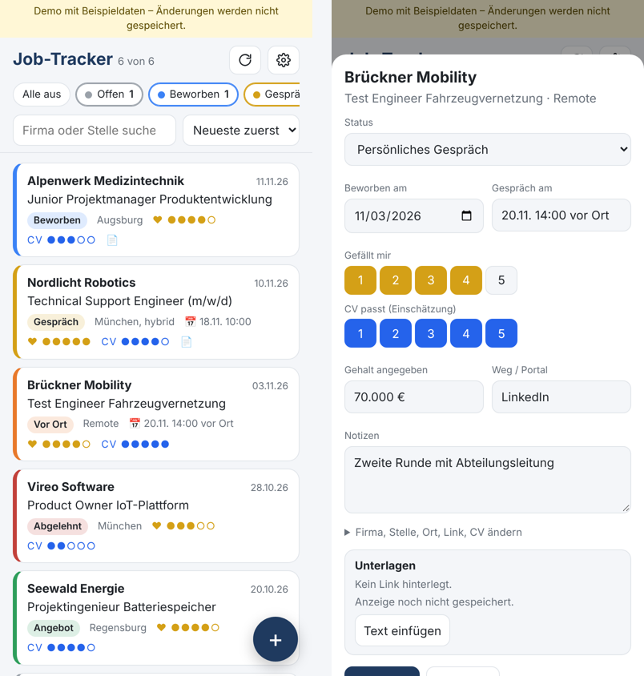

# Job-Tracker

**Deutsch** | [English](README.en.md)

Eine kleine Web-App, mit der ich meine Bewerbungen verwalte. Die Daten liegen in einer eigenen Google-Tabelle, die App läuft auf iPhone, iPad und am Rechner.

Created by **Matthias Lobinger** · [LinkedIn](https://www.linkedin.com/in/matthias-lobinger)

**Ausprobieren ohne Einrichtung:** [Demo mit Beispieldaten](https://lobi1994.github.io/Job-Tracker/#demo)

## Was die App kann

- **Status pro Bewerbung:** Noch nicht beworben → Beworben → Zum Gespräch eingeladen → Persönliches Gespräch → Jobangebot / Abgelehnt
- **Filter an/aus pro Status**, Suche nach Firma oder Stelle, Sortierung nach Datum, Status oder Bewertung
- **Zwei Bewertungen:** wie gut mir die Stelle gefällt und wie gut mein CV zur Stelle passt (jeweils 1–5)
- **Stellenanzeige speichern:** per Link, per eingefügtem Text oder per iOS-Kurzbefehl direkt aus Safari. So bleibt die Anzeige lesbar, auch wenn sie offline geht. Vor dem Überschreiben einer gespeicherten Anzeige wird nachgefragt; eine falsche Anzeige lässt sich löschen.
- **Gesprächstermine, Gehaltsangabe, Portal, CV-Datei und Notizen** pro Bewerbung, mit Link zur CV-Datei in Google Drive
- **„Jetzt bewerben“-Knopf:** öffnet die Anzeige und sichert den Anzeigentext dabei automatisch
- **Hard- und Soft-Skills** aus der Anzeige, abgeglichen mit dem eigenen Profil (Passung in %)
- **Claude-Anbindung (optional):** Bewertung „CV passt“ mit Begründung und zugeschnittener CV per Knopfdruck, über eine geplante Claude-Aufgabe
- **Gmail-Abgleich:** erkennt Absagen, Einladungen und Eingangsbestätigungen in deinen Mails setzt Eingangsbestätigungen automatisch auf „Beworben“ und fragt bei Absagen und Einladungen in der App nach
- Funktioniert als App auf dem Home-Bildschirm und zeigt beim Start sofort den letzten Stand

## Aufbau

| Teil | Technik | Aufgabe |
|---|---|---|
| Datenbank | Google Sheets | ein Blatt „Bewerbungen“, ein Blatt „Anzeigen“ für die Texte |
| Schnittstelle | Google Apps Script (`google/Code.gs`, `google/Mail.gs`) | Web-App mit JSON-API, Schlüsselprüfung, Abruf und Auswertung von Stellenanzeigen (JSON-LD `JobPosting`) |
| Oberfläche | HTML, CSS, JavaScript ohne Framework (`index.html`) | läuft auf GitHub Pages, Service Worker für schnellen Start |
| Kurzbefehl | iOS-Kurzbefehle + `kurzbefehle/job-speichern.js` | liest die geöffnete Anzeige in Safari aus und schickt sie an die Tabelle |

Deine Daten bleiben in deiner Google-Tabelle. Die Seite auf GitHub enthält keine Daten, nur die Oberfläche. Ohne deinen persönlichen Schlüssel kann niemand etwas lesen oder ändern.

## Einrichten

Schritt für Schritt in der [Anleitung](ANLEITUNG.md), ca. 15 Minuten.

## Änderungen

Siehe [CHANGELOG.md](CHANGELOG.md). Dort steht bei jeder Version, ob du in Apps Script etwas neu bereitstellen musst.

## Grenzen

- LinkedIn und manche Workday-Seiten lassen sich nicht über den Link abrufen. Dafür gibt es den Kurzbefehl in Safari oder das Einfügen des Textes.
- Eine Anzeige wird mit höchstens 45.000 Zeichen gespeichert (Zellgrenze von Google Sheets).
